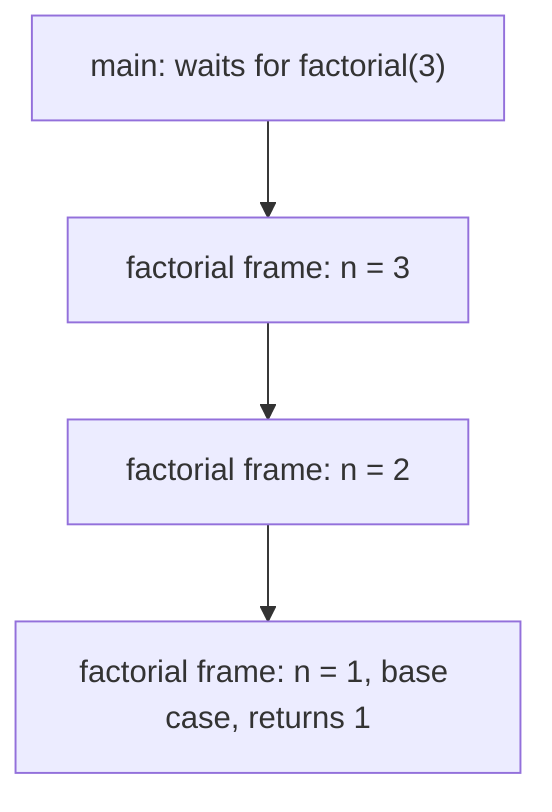
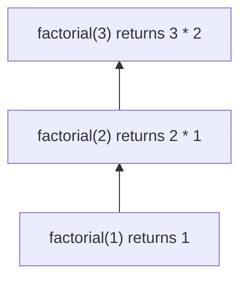
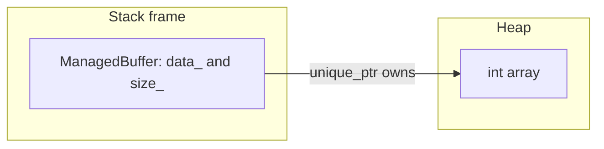
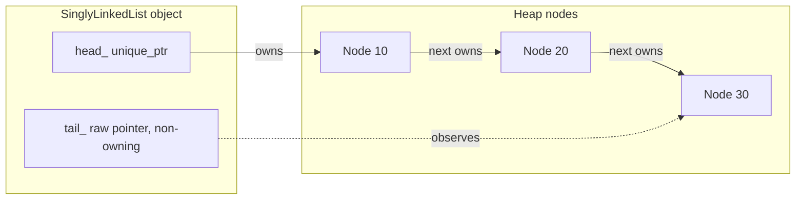
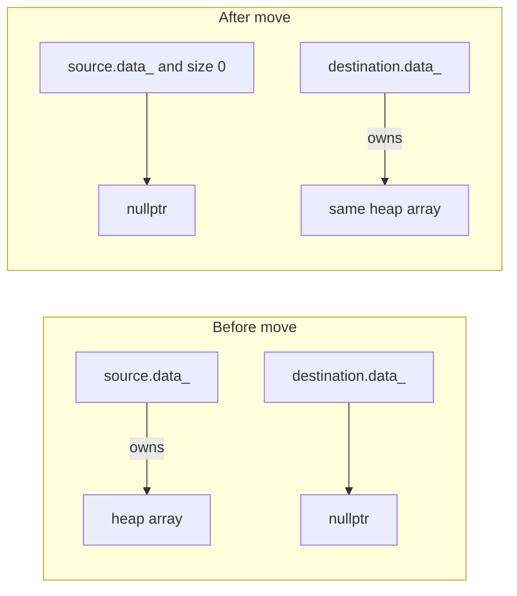
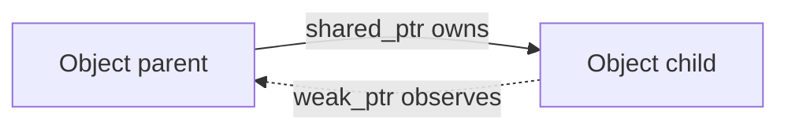

# Memory model

This note is a picture of where Day 2's objects live. The stack holds function frames and the objects you declare as locals. The heap holds memory whose lifetime you control, which in this repository means memory owned by `std::unique_ptr`.

A raw pointer in this code is an observer. It is marked non-owning at the declaration. It must not be passed to `delete`.

## Stack frames during recursion

`factorial(3)` does not run as one flat block of work. Each call pushes a frame. The frame stores the parameter, the return address, and space for the value that comes back from the recursive call. The base case is the frame that does not push another one.

Unwinding multiplies on the way back up:

The call stack is not the heap. Those frames disappear when the function returns. A missing base case keeps pushing frames until the stack is exhausted. That is why `factorial`, `fibonacci`, `binary_search`, and `directory_depth` each have a case that does not recurse.

Memoized Fibonacci still uses O(n) stack frames on the first descent from `n` down to `1`. The memo table is a separate `std::vector` on the heap. The table is what turns the exponential call tree into linear work. It does not remove the first chain of frames.

Binary search pushes O(log n) frames. Each frame stores `low`, `high`, and `mid`. The base case is the empty half, `low >= high`.

## A local object that owns a heap array

`ManagedBuffer` is often a local variable, so the object itself sits in a stack frame. The `int` array cannot live in that frame: its length is chosen at run time. `data_` is a `std::unique_ptr<int[]>` stored inside the object. The pointer value is on the stack. The array is on the heap. When the frame ends, the destructor runs, and the `unique_ptr` frees the array.

There is no `delete[]` in `src/managed_buffer.cpp`. Ownership is the member. Resetting `data_` in the destructor makes that boundary obvious; the member would also free the array when it is destroyed.

## Linked-list ownership

The list object can live on the stack. Every node is allocated on the heap because the length is not fixed and the nodes must outlive the function that inserted them.

`head_` owns the first node. Each node's `next` unique_ptr owns the following node. `tail_` is a raw pointer drawn as a dashed arrow: it does not own the last node. It exists so `push_back` does not walk the chain. If the list is empty, `tail_` is null.

An iterator holds the same kind of non-owning address. Copying an iterator copies the address, not the node. After `clear`, `erase`, `remove`, or destruction, that address is invalid.

### Why `clear` is a loop

Destroying a `unique_ptr` destroys the owned node, and that node's `next` member would destroy the following node. On a long chain that recursion is deep enough to overflow the call stack. `clear` walks the chain in a loop:

1. Move `head_->next` into `head_`. The old first node is destroyed with a null `next`, so its destructor is constant time.
2. Repeat until `head_` is null.
3. Set `tail_` to null and `size_` to 0.

`DirectoryNode` uses the same idea. A defaulted destructor would recurse along the height of the tree. The out-of-line destructor detaches children and destroys them in a loop.

## Ownership transfer on move

A move does not allocate and does not copy elements. It steals the owning pointer and leaves the source empty. The heap array does not move; the pointer to it does.

The two drawings are one allocation at two moments. After the move, the source is still a live object. Its destructor is safe because it owns nothing. Using it as if it still held the old elements is a logic error. Assigning to it or destroying it is allowed.

Copy is a different picture: a second heap array is allocated and the integers are duplicated. Changing one buffer does not change the other. The tests compare the raw `data()` addresses to show they differ. Those addresses are non-owning views.

Self-move is guarded. Without the `this != &other` test, a move assignment would steal the pointer from itself.

## `shared_ptr` and `weak_ptr`

This repository uses `unique_ptr` because each node, each directory child, and each shape has one owner. `shared_ptr` is the tool for a resource that genuinely has several owners. The last `shared_ptr` to drop runs the deleter. Copying a `shared_ptr` increments a control-block count. That count is an extra heap allocation shared by the owners.

A cycle of `shared_ptr` never reaches a count of zero. `weak_ptr` is the back edge that observes without owning. `lock()` yields a `shared_ptr` if the object is still alive, and an empty `shared_ptr` if it is not.

The solid arrow keeps the child alive. The dashed arrow does not keep the parent alive, so the cycle is broken.

## What the sanitizers watch

AddressSanitizer checks the heap picture: out-of-bounds access, use after free, double free, and leaks. UndefinedBehaviorSanitizer checks language assumptions: signed overflow, invalid shifts, misaligned access, and similar. A clean sanitizer run means the ownership arrows in these diagrams match the code. It does not prove that every algorithm is correct. The Catch2 tests cover the contracts; the sanitizers cover the memory.
